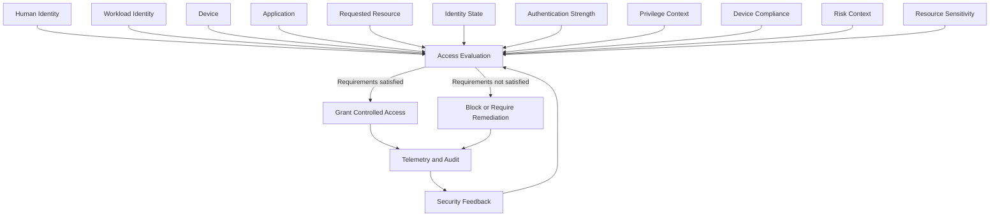

# Zero Trust Architecture

## Objective

The laboratory implements an enterprise access architecture in which
successful authentication alone is not sufficient to establish trust.

Every access decision should evaluate relevant security context before
access is granted.

## Architecture model

The diagram is original to this project and represents the laboratory's
access-decision model.

## Trust dimensions

### Identity

The system must establish which identity is requesting access and whether
that identity remains permitted to operate.

### Authentication

Authentication requirements must be proportional to the sensitivity and
privilege of the requested operation.

### Privilege

Administrative privilege must be minimized, separated from normal
productivity activity, and temporary where the platform supports it.

### Device

Device state can influence access decisions.

Managed and compliant devices can receive different access outcomes from
unknown or non-compliant devices.

### Application

Applications and workload identities must receive only the permissions
required for their documented purpose.

### Context

Location, sign-in risk, identity risk, and other available signals can
change an otherwise valid access decision.

### Resource

Access controls must account for the sensitivity and impact of the target
resource.

## Decision states

An access request can result in one of the following logical outcomes:

1. Grant.
2. Grant after additional authentication.
3. Grant after device or security remediation.
4. Grant with constrained session conditions.
5. Deny.

## Administrative separation

Normal productivity identities must not be used as the default identity for
high-impact tenant administration.

Administrative operations should use dedicated privileged identities.

Emergency identities are separate from both normal identities and routine
administrative identities.

## Feedback loop

Access controls are not treated as static configuration.

Audit information, security findings, failed tests, incidents, and later
Security Operations exercises must feed improvements back into the access
architecture.

This feedback loop is intentionally designed so that the separate Security
Operations and Incident Response project can validate controls implemented
here.
